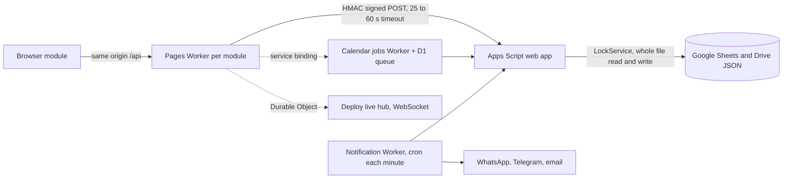
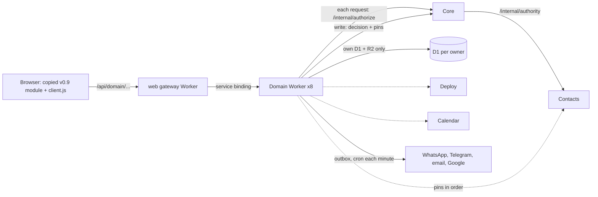

# GSiS v0.9 to v1 trace ledger for Codex

Model: Claude. Date: 15 November 2026 (Asia/Singapore). Status: advisory trace record. It grants no merge, deployment, migration or live data authority.

## 0. Scope, method and limits

**Owner goal.** Keep the v0.9 frontend look. Make the v1 backend web native on Cloudflare. Remove the Google Apps Script and Drive middle layer, because it is slow and weak for concurrent users.

**Owner problems to solve.** (1) v1 is incomplete. (2) v1 data validation is too strict.

**What was traced.**

| Item | Value |
| --- | --- |
| Main inspected | `d774081` (15 Nov 2026) |
| Open PR stack tip inspected | `77e30ee` (PR 175, contains PR 160 to 174) |
| Contacts B draft inspected | `0e6deff` (PR 176) |
| v1 spec sources | PR 137 at `b6cd8f5`: Revision 49 (1,304 lines) and Accelerated Spec v1.1 (613 lines) |
| Hosted UAT evidence | PR 162 Run B at `ee05242`; PR 159 queue (49 finding IDs) |
| Branches scanned | All 240 remote heads |

**Method.** Static trace only. I read the v0.9 browser calls, Pages Workers and Apps Script dispatchers. I read the v1 gateway, the eight domain services, the browser adapter and the build patcher. I compared operation names on both sides by script, then checked each suspect by hand.

**Limits.** No build, test or live request was run for this ledger. A "no handler found" row means the name does not occur in the v1 service, adapter or build patch. Prove each row with one real request before you fix it. No v0.9 formal spec exists in the repository. Section 1 is a reconstruction from code.

**Privacy.** This repository is public. This file has no staff names, numbers, operation IDs or school data. Keep it so.

## 1. Bottom line

1. v1 is not a new frontend. It is the v0.9 frontend copied at build time, with about 83 text patch lines in `scripts/v1/build-web.mjs`, talking to eight Cloudflare Workers. So the look is kept by copy, and every missing server operation shows as a broken button, not as a missing screen.
2. 183 frontend operations are inventoried in `v1/web/parity.json`. Only 7 have a recorded browser pass. 176 are "Not tested".
3. At least 19 Roster operations that the copied frontend still calls have no v1 handler. The server answers `UNKNOWN_OPERATION` 404. Stapler locking is among them.
4. The hosted migration (Run B) could not finish through the frontend. Contacts, Calendar, Venues, Roster settings and Roster types all needed direct D1 fallback. Roster baseline is still blocked.
5. Most hosted failures are validation rejections, not crashes. v1 rejects data that v0.9 stored and flagged. The fix is a rule change (Section 6), not more patches.
6. v1 removed Apps Script, but one save now crosses the gateway, the domain Worker, Core and Contacts, plus up to four pin owners. Cold useful screen p95 was 7.4 s against a 3 s target. Speed is not yet proven better for users.

## 2. Map A: v0.9 as built (reconstructed spec)

| Module | Browser entry | Pages Worker route | Apps Script action | Authoritative store |
| --- | --- | --- | --- | --- |
| Deploy | `/api/bootstrap`, `sync`, `delta`, `change` (about 45 sub operations), `lease`, `publishReview`, `relief`, `roleTruthTable`, `landmark/*`, `live` | `public/_worker.js` | `backend/Code.gs` plus Planning, Relief, FieldStore | Deploy workbook |
| Contacts | `/api/bootstrap`, `data`, `save-data`, `save-diy`, `save-receipt`, `kp`, `recalculate-data`, `recover-save` | `contacts-update/public/_worker.js` | `Contacts_*.gs` | Contacts workbook |
| Roster | `/api/read`, `operations` (about 90 operations), `update`, `upload`, `profile`, `external`, WhatsApp webhook | `roster-update/public/_worker.js` (1,751 lines) | `rosterRead`, `rosterOperations`, `rosterUpdate`, `rosterUpload`, `rosterInbox` in `Roster*.gs` | Drive index and operations files |
| Calendar | `/api` with action (21 actions), `calendar-jobs`, `calendar-changes` | `calendar-update/public/_worker.js` | `calendar-backend/Code.gs` (10,415 lines) | Calendar workbook, then Google Calendar |
| Venues | `/api/read`, `/api/command` (18 operations) | `venues-viewport/public/_worker.js` | `venues-backend/Code.gs`, `Domain.gs` | Venues records |
| Layout | `/api/profile`, `public/campus`, `unit/rename` | `layout-update/public/_worker.js` | `LayoutRepository.gs` | Layout repository sheet (chunked JSON) |
| LORD, OVERLORD, STARLORD | `/api/transaction` with action, `reference`, `dashboard`, `board`, `jobs` | three `_worker.js` | `lord-suite/Source/backend/Code.gs` (7,555 lines) | LORD workbooks and Drive photos |

**v0.9 rules that matter for v1.**

1. One writer at a time per workbook (Apps Script lock). This is the concurrency limit the owner wants removed.
2. Whole document read and write for each save. This is the speed limit.
3. Data rule: values outside the current choice list are **retained and flagged**, not rejected. The Deploy source text says so: "Existing staff values outside these choices are retained and flagged."
4. Identity is by name with modifiers (subject, employment). Duplicate basic names are normal and are told apart by modifiers.
5. A venue cell may hold more than one room.

## 3. Map B: v1 as built

| Edge (service binding) | Purpose |
| --- | --- |
| web to CORE, CONTACTS, DEPLOY, ROSTER, CALENDAR, LORD, VENUES, LAYOUT | Public gateway |
| every domain to core `/internal/authorize`, `/internal/decision` | Session, capability, decision evidence |
| core to contacts `/internal/authority` | Accepted SMC, EO, School Leader facts |
| deploy to contacts `/internal/projection`, `/internal/register-provisional` | Staff facts, new Staff ID |
| deploy to venues `/internal/catalogue`, `/internal/source-begin` | Room register, publication fence |
| roster to contacts `/internal/projection`; to venues `/internal/catalogue`, `/internal/source-begin`; to calendar `/internal/dates`; to deploy `/internal/publication/verify` | Baseline mapping, parity, workload |
| lord to contacts `/internal/projection`; calendar to contacts birthdays; contacts to deploy projection | References |

**v1 write protocol (one protected save).** Gateway, then domain, then Core authorize (which reads Contacts), then `prepareOperation` in D1, then `admit` (Core decision plus pins acquired in order Core, Contacts, Deploy, Calendar), then one D1 batch commit with receipt and audit, then pin release. A pin that is uncertain stays held for recovery.

## 4. Map C: side by side

| Aspect | v0.9 | v1 | Verdict |
| --- | --- | --- | --- |
| Frontend | Seven Pages apps | Same files copied, about 83 build patch lines, shared `client.js` | Look kept. Fragile: a v0.9 text change breaks the v1 build |
| Transport | Pages Worker to Apps Script | Gateway to Worker over service bindings | Goal met |
| Store | Sheets and Drive | Eight D1 databases plus R2 | Goal met |
| Concurrency | One global lock per workbook | Row revision compare and swap, idempotent `operationId` | Goal met in design |
| Cross domain consistency | Same script, same lock | Pins across four owners, no cross D1 transaction | New failure class: "prepared, outcome unknown" |
| Validation | Retain and flag | Reject | Regression against owner intent |
| Live updates | Deploy WebSocket hub | None found in v1 | Gap. Check that polling fallback is active |
| Operations with a v1 handler | All | Most. See Ledger A | Incomplete |
| Runtime proof | Production use | 7 of 183 browser passes | Incomplete |
| Initial data load | Not needed | No frontend seed path for Venues, Calendar bulk, Roster types order | Incomplete |

## 5. Ledger A: incompleteness (operations)

Status words: **Absent** means no handler string found at `77e30ee`. **Blocked** means it exists but failed in hosted UAT. **Unproven** means it exists with no browser pass.

| ID | Module | v0.9 operation or route | v1 state | Evidence | Action for Codex |
| --- | --- | --- | --- | --- | --- |
| A01 | Roster | `acquireStaplerLock`, `renewStaplerLock`, `releaseStaplerLock` | Absent | Called by `roster-stapler-ui.js`. `policy()` in `v1/services/roster/service.mjs` throws `UNKNOWN_OPERATION`. A `/lease` route exists but nothing maps to it | Map the three names to `/lease`, or add handlers. Stapler edit is unusable until then |
| A02 | Roster | `confirmTimetableReconcile`, `migrateStaplerPlans` | Absent | Preview twins are in shared READS. The confirm writes are not in `writes` | Add writes or hide the controls |
| A03 | Roster | `resolveAbsenceIntake`, `retryAbsenceIntake`, `retryBackgroundJob` | Absent | Called by the copied frontend | Decide: native v1 intake review, or remove the panel |
| A04 | Roster | `deliveryReview`, `dismissDeliveryIssues` | Absent | `roster-delivery-review-ui.js` is copied | Port to v1 outbox states |
| A05 | Roster | `peerMailReview`, `reviewPeerMail`, `sendPeerMail` | Absent | Copied frontend calls them | Port or remove |
| A06 | Roster | `contactCreate`, `publishDaily`, `statisticsRPercent`, `recordRecoveryCheckpoint`, `recoverVenuesSync`, `quiet-mode` | Absent | Listed in `parity.json` as adapted, no handler | Port, or mark retired with owner consent |
| A07 | Roster | Timetable preparation pages (3 operations) | Replaced, omitted from build | Build omits `timetable-preparation.*` | Confirm native import covers the need |
| A08 | Deploy | `/api/roleTruthTable`, `/api/saveRoleTruthTable` | Absent | v0.9 `app.js` calls them | Roles moved to Core. Remove the control or route to `/admin/` |
| A09 | Deploy | `/api/landmark/catalog`, `search`, `unit`; `/api/campus-map`; `/api/layout-reference` | Absent | v0.9 Deploy assets call them | Route to Layout service or drop `landmark.html` from the copy |
| A10 | Deploy | `/api/live`, `/api/live-ticket` (WebSocket) | Absent | No WebSocket or Durable Object in v1 | Confirm the UI falls back to `delta` polling. Record the interval |
| A11 | Deploy | `/api/commands`, `batchCells` | Absent | v0.9 edge command queue | Confirm `/change` covers all queued cell edits |
| A12 | Contacts | `/api/sysFields`, `offload`, `membership`, `save-admin-table` | Absent | Paths exist in v0.9 assets, no v1 route | Verify whether the copied screens still call them. PR 176 does not add them |
| A13 | Contacts | `kp` (grant SMC access) | Replaced by Core admin link | Build patch | Access grants were not migrated. v1 Sys Admin list is empty (Run B) |
| A14 | Layout | `/api/unit/rename` | Absent | v0.9 Layout calls it | Add to Layout service or remove the control |
| A15 | Venues | Initial room register create or import | Absent | Run B B-V01: register was empty, Excel import disabled | Build a seed path. All dependent modules block without it |
| A16 | Calendar | Bulk event import | Absent | Run B copied 424 events by D1 | Build import or accept D1 migration as the only path, with owner consent |
| A17 | LORD | Cart level booking (10 carts of 3 trolleys) | Blocked, fix in PR 167 | UAT021 to 023 | Land PR 167, retest hosted |
| A18 | LORD | 5 minute reminders, 5 minute overdue monitor | Different behaviour | UAT009, UAT010: v1 uses other timings and hourly summary | Restore v0.9 timing semantics |
| A19 | All | 176 of 183 inventoried operations | Unproven | `v1/web/parity.json` | See Section 10, step 4 |

**Hosted blockers still open (from Run B).** These stop the migration now.

| ID | Finding | State |
| --- | --- | --- |
| H01 | Roster baseline save: `Decision is bound to another operation` (RUN-B-025) | Fix claimed in PR 172. Not deployed. Not verified |
| H02 | Roster baseline: one room select per label, cannot map a two room cell; 8 labels unresolved (B-R02) | Open |
| H03 | Deploy publication stays "prepared", no pointer, no venue fence (B-D03) | PR 170 bounds the query. Hosted cause unproven |
| H04 | Contacts: 467 stored values render blank, iCON, CES, EXT (B-C01) | PR 173 |
| H05 | Contacts to Deploy projection drops modifiers; non EO staff listed as teachers (B-D01, B-D02) | PR 173 |
| H06 | Calendar year generator: week zero wrong, preview promises events, writes none (B-CA01) | Open, unimplemented |
| H07 | Teaching information unavailable in Contacts until a Deploy publication exists | Depends on H03 |
| H08 | Application access grants not migrated to Core | Open, owner decision |

## 6. Ledger B: validation that is too strict

**Rule accepted by the owner on 15 November 2026** (recorded in `docs/coordination/OWNER_DIRECTIVES.md`). Be strict on who and when. Be lenient on what.

1. **Keep strict (reject):** session, school, capability, revision compare and swap, idempotent operation identity, accepted SMC, EO and School Leader authority, payload size bounds.
2. **Make lenient (accept, store, flag):** values outside a catalogue, missing optional facts, duplicate display names, multi value cells, unknown capacity, label spelling. This is the v0.9 rule (Section 2, rule 3).
3. **Never treat absent as empty.** An untouched field in a form is not an instruction to clear it.

| ID | v1 rule today | Where | v0.9 behaviour | Harm seen | Change wanted |
| --- | --- | --- | --- | --- | --- |
| B01 | A staff row with a value outside the catalogue is rejected: `CATALOGUE_SELECTION_REQUIRED` | `v1/services/contacts` | Retained and flagged | UAT003, UAT024. Rows could not be saved | Owner already decided: remove the catalogue prerequisite from ordinary writes (PR 158, PR 176). Finish it |
| B02 | A new person with an existing basic name is rejected: `IDENTITY_SELECTION_REQUIRED`. The guard runs before the qualified name is built | `v1/services/contacts/service.mjs` | Duplicate basic names allowed when modifiers differ | RUN-B-021. Two real people could not be created | Compare the qualified name (basic name plus modifiers). Warn, do not reject, when Staff IDs differ |
| B03 | Calendar event with more than one room is rejected: `INVALID_VENUE`. The whole comma joined value is compared with one ID | `v1/services/calendar/service.mjs` near line 512 | Up to six rooms | B-CA02. 32 real multi room events exist | Validate each ID. Keep order and free text |
| B04 | Roster baseline needs exactly one canonical Venue ID per source label | `v1/services/roster/service.mjs` near lines 1061, 1155 (`VENUE_MAPPING_REQUIRED`) | Free text room labels | H02 | Allow many rooms per label. Allow "unmapped, keep label" with a flag |
| B05 | Roster baseline needs a Staff ID for every teacher label, chosen by hand, 100 selectors | Same file near lines 1128, 1150 | Name bridges match automatically | 169 manual choices per upload; lost on any rejection | Auto match by exact name bridge. Ask only for unresolved labels. Keep choices after a failed save |
| B06 | Venue capacity must be an integer from 0 to 100000. Unknown is not allowed | `v1/services/venues/service.mjs` near line 542 | Capacity may be unknown | B-V01: no seed path | Accept null as "unknown" |
| B07 | Deploy IDs must match `[A-Za-z0-9][A-Za-z0-9_.:@/-]{0,127}`. Text max 160 | `v1/services/deploy/validation.mjs` | Labels with spaces and brackets are used as keys in source data | Risk for copied keys, for example a room label with a bracket | Test with real key shapes. Separate ID rules from label rules |
| B08 | Relief allocation refuses to run without a verified Deploy publication and verified timetable: `WORKLOAD_UNVERIFIED`, `TIMETABLE_UNVERIFIED` | `v1/services/roster/allocation-snapshot.mjs`, `context.mjs` | Allocation ran on current saved data | Roster is dead until Deploy publishes (H03) | Owner decision needed. Option: allow allocation with workload marked "estimated", block only auto publish |
| B09 | Relief demand and teacher count show zero when accepted EO evidence is missing | Deploy calculation path | Derived from role | UAT016, UAT017, UAT028 | Do not infer authority. But show the planning numbers as "unverified" in place of zero |
| B10 | Deploy teacher list shows every active Contacts person, or none, depending on projection shape | `v1/services/deploy/model.mjs` `mergeContacts` | 98 eligible EO teachers of 161 active staff | B-D02 | PR 173. Verify by identity, not by count |
| B11 | Untouched multi selects are sent as empty arrays and clear stored tags | `v1/web/shared/contacts-catalogues.js` | Not applicable | RUN-B-023. Real data loss | PR 174. Apply rule 3 to every form in the suite |
| B12 | Reference equality by JSON string order | Same file | Not applicable | Saved values show as "Not recorded" | PR 174. Compare by catalogue ID, revision, code |
| B13 | A decision is bound to one action name. A delegated call with a valid but different action is denied: `SERVICE_DENIED` | `v1/runtime/admission.mjs` line 136, `v1/services/core/service.mjs` line 753 | Not applicable | RUN-B-020, RUN-B-025. Two admin saves dead | PR 172 widens the Calendar allow list. Audit every cross service call for the same class of error |
| B14 | Save status in the copied UI checks `planning`. v1 sends `draft` | Deploy projection | Not applicable | UAT019 | PR 161. Search for other enum renames |
| B15 | Year generator fills gaps and renumbers weeks to fit its own model | `v1/services/calendar/service.mjs` `structure()` | Week 0 exists. Gaps are kept | B-CA01 | Follow source semantics. Do not normalise school data |
| B16 | A lost response leaves the form locked. Discard is disabled until terminal proof | Shared client and each module | Retry was allowed | B-R01, UAT004 | PR 163, 168, 175. Always give the user one safe exit within a bounded time |

**Note on B13 and B16.** These are not content validation. They are the cost of the pin and decision protocol. Each new cross service call is a new way to be denied. Ask the v1 coordinator whether low risk admin settings (absence type order, system config) need four owner pins at all.

## 7. Ledger C: frontend look changes

The owner wants the v0.9 look kept. These build patches change what the user sees. Each needs owner consent or a revert.

| ID | Module | Change | Source |
| --- | --- | --- | --- |
| C01 | Roster settings | Workload rules, consecutive rules, preferences and default preferences are hidden. "Business preferences" becomes "Allocation layers". Annual utilisation is replaced by daily capacity | `build-web.mjs`, `roster-settings-ui.js` patch. Owner approved the policy; the hidden panels still need a parity note |
| C02 | Deploy | Membership table is read only. HR Terms and master options cannot be edited. Publish needs a new capability | `updateDeploy` |
| C03 | Deploy | "Purge audit log" becomes "Archive audit display" | `updateDeploy` |
| C04 | Contacts | "Add role" opens Core admin. Extra authority and catalogue panels are added below the grid | `updateContacts` plus `contacts-authority.js`, `contacts-catalogues.js` |
| C05 | Contacts | Role shows a code (for example `HOD-MTL`) in place of the source label. Signature shows "Teacher" in place of the formal role | UAT026, RUN-B-024 |
| C06 | Calendar | User alias text box becomes a verified account picker. Archive text and flow changed | Calendar patches |
| C07 | LORD | "Bookings cannot be edited" becomes "can be revised before collection" | LORD patch |
| C08 | Roster | System health page moves to `/admin/#health`. Three timetable preparation pages are dropped | Build omit list |
| C09 | Calendar | Week 0 is blank in the grid | Run B |
| C10 | Venues | Admin view rewrites the URL to the suite root | B-V01b, PR 171 |
| C11 | All | Only the first screen of each module has a screenshot check, 18 images. No interaction level visual comparison exists | `parity.json` |

**Structural risk.** The patcher uses exact string replacement and throws "Visual baseline changed" when the v0.9 text differs. v0.9 hotfixes are allowed until 20 November. Each one can break the v1 build. After the v0.9 freeze, vendor the copied sources into `v1/web/` and stop patching live v0.9 files.

## 8. Ledger D: speed and concurrency

| ID | Finding | Evidence | Action |
| --- | --- | --- | --- |
| D01 | Every request, reads too, calls Core, and Core calls Contacts | `v1/runtime/security.mjs` `authorize`; `v1/services/core/service.mjs` line 334 | Cache the decision for its `validUntil` window per session and action. Measure before and after |
| D02 | Cold useful screen p95 7,354 ms. Target 3,000 ms. Warm 1,213 ms | `docs/v1/accelerated-delivery/PARITY.md`, local fixture, Contacts only | Fix cold path first. Measure every module on the hosted site |
| D03 | Committed write p95 908 ms, local, 30 users | Same | Acceptable. Not yet measured hosted or for Roster |
| D04 | Allocator: 150 demands gave 15 assigned, 135 unresolved | Same | This is a completeness issue, not speed. Compare with v0.9 output on the same day |
| D05 | Venue publication staging of 40,800 intervals took 29.9 s locally | Same | Likely linked to H03. Stage in the background, not in the publish request |
| D06 | A prepared operation that never settles blocks later saves | B-R01, B-D03 | Add a bounded automatic abort for pins that never reached commit |
| D07 | No push channel. Two users learn of each other only on the next poll | A10 | Set and document the poll interval. Consider one Durable Object later |

## 9. Ledger E: specification state

1. The v1 requirements baseline is PR 137 (unmerged, approved as a record). Later owner decisions override parts of it: Admin or Contacts Power User alone may accept; catalogue prerequisite removed; inactive staff excluded from readiness.
2. Three Revision 49 companion files are in no branch: the staged handoff plan, the Tranche 1 UAT and the T1A readiness handoff. `T1B_REVISED_PLAN.md` cites them by digest only.
3. No v0.9 specification exists. Spec precedence item 4 is "current v0.9 behaviour". Section 2 of this file is the nearest written form. Run B owner decision 1 says v0.9 is the source of truth for data, names and behaviour.
4. `CLAUDE.md` says Claude coordinates. `docs/v1/AGENTS.md` says ChatGPT coordinates v1 and Claude reviews. One of the two files is stale.
5. v1 on the school hostname now holds real personal data (Run B). Treat every further load as an owner decision.

## 10. Ordered work for Codex

Do the steps in order. Do not start a step until the one before has hosted proof.

1. **Land the reviewed stack.** PR 160 to 175 are approved by Claude at exact heads. Merge parents first, retarget children, deploy as v1.01, then rerun the Run B checks on the hosted site. Until this is done, every new finding may be a duplicate.
2. **Adopt the Section 6 rule.** Get owner consent for "strict on who and when, lenient on what". Then fix B02 to B09 and B15 as one bounded validation job. Finish PR 176 for B01.
3. **Unblock Roster.** A01 first (Stapler lock), then H02 and B04, B05 (baseline mapping), then B08 (allocation without publication). Roster is the mandatory last migration step and the daily critical path.
4. **Close Ledger A.** For each Absent row: port, map, or retire with owner consent. Then replace "Not tested" in `parity.json` with a real browser result for each of the 176 operations. Start with the 20 operations staff use daily: report absence, assign relief, publish, notify, book venue, book cart, collect, return, save event.
5. **Seed paths.** A15 and A16. A fresh school install must work with no D1 hand edits.
6. **Look parity.** Resolve Ledger C with the owner. Add an interaction level screenshot comparison for the daily operations in step 4.
7. **Speed.** D01, D02, D06. Publish hosted p95 for read, write and first useful screen for each module.

**Done means:** a hosted browser run against migrated data, with the v0.9 screen beside it, shows the same result. A green CI run or a D1 readback is not done.

## 11. Owner decisions needed

1. Validation rule in Section 6: **accepted, 15 November 2026.** Codex may plan B02 to B09 and B15 as one bounded job under the normal claim workflow.
2. B08: may relief allocation run before a verified Deploy publication exists, with numbers marked "estimated"?
3. A03 to A06: which Roster panels may be retired in v1?
4. Ledger C: which look changes are accepted?
5. H08: migrate application access grants to Core, or grant afresh?
6. Section 9 item 4: settled. The 12 November directive appoints ChatGPT as v1 coordinator. `CLAUDE.md` needs a one line correction for v1.
7. Supply the three missing Revision 49 files, or declare them superseded.

## 12. What this ledger does not prove

1. That an Absent operation fails for a real user. The copied UI may hide the control by role or flag.
2. The hosted build identity. Run B last verified `26bbccd`.
3. Any hop count or latency on Cloudflare. Section 3 is read from code.
4. That PR 160 to 176 fix what they claim on the hosted site.
5. Completeness of the operation scan. It matched literal names. Dynamically built names would be missed.
