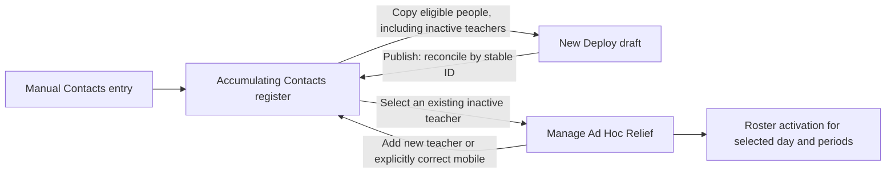

# Contacts, Deploy and Roster: sequential updates and working copies

Owner design, 16 November 2026. Recorded by Codex; coordinator ChatGPT v1. **Documentation on main, not an implemented change.** All seven clarification questions, including the final-round Duplicate version question, have been answered and incorporated. Independent Claude review has not been performed on this document. Section 6 records engineering recommendations and code-level edge cases; these are not claims of implemented behavior.

Source inspection: main `08791559faf91aeb3307f655a199ed0b2d420580`. Documentation claim: `3c80c023bb46eb565b62e2052416f78de4a48b8c`, [task record](../../coordination/tasks/v1-contacts-lifecycle-design.md). The owner explicitly requested this design as Markdown on main. No product change, unrelated PR merge, migration, deployment, live record access or provider operation is authorised by publishing it.

Final edge-case review inspected main `ad9d756b62bc60a999a01a61187e2e53f6fcaeec`; follow-up documentation claim `695e9ebc705d8166b21a385c889a624db5eee5d4`. This was repository/source inspection, not behavioral or hosted testing.

## 1. Owner's model

> “There is no authoritative database of contacts. The contacts info is sequentially updated or held in partial drafts by design.”

Contacts is the accumulating shared register at a point in time. A Deploy draft holds its own valid working copy. A publication updates the shared register according to the field-specific rules below. Roster can add an ad hoc teacher and explicitly correct a mobile number. No application has unconditional, permanent precedence over every field simply because it stores a Contacts record.

Partial records are legitimate. They do not need invented optional values or a separate ordinary-data acceptance step to become valid working records. One stable Staff ID links the person across Contacts, Deploy versions, Roster and historical activity. Each stage has its own data, change history and completion state.

This describes business precedence and the user workflow. An implementation may still use one controlled writer for each physical database and a shared identity/name index. Those technical boundaries must enable the authorised updates, not reintroduce a permanent Contacts-master veto or a manual proposal-acceptance detour for these ordinary fields.

## 2. Confirmed lifecycle

| Stage | Confirmed rule |
| --- | --- |
| Initial seed | Manual entry in the Contacts viewport establishes that record's truth from that point in time. Later legitimate edits/publications can update it. |
| New Deploy draft | Copy the current Contacts details into a version-owned contact list. Include inactive teachers. Exclude MK, SAT, SL, OSO, DE, EAS, Science Lab Tech and Support staff. Use explicit recorded classifications; never infer identity or authority from a person's name. |
| Duplicate Deploy version | Refresh existing teachers from **current Contacts**, just as for a new version. Retain the selected version's planning assignments and its new teachers that do not yet exist in Contacts, with their original stable IDs. Copying does not restamp an unchanged Basic Name. |
| New teacher in Deploy | A Deploy Power User may add a teacher with Basic Name and modifiers sufficient to derive a nonclashing TTb Name. Generate a stable ID at creation, even before the teacher reaches Contacts. Default **Active = Yes**. Mobile and unrelated optional details are not prerequisites. |
| Publish Deploy | Match people by stable ID. Append newly introduced IDs to Contacts. Apply Basic Name, deployment-tag and Active rules in section 4. This is an update of the accumulating register, not replacement/deletion of the entire directory. |
| Active reconciliation | For a represented ID, Active follows the published Deploy row in both directions: active to inactive, or inactive to active. An excluded/omitted person is not an instruction to mark them inactive. |
| Publication timing | Use the current publication immediately. There is no future-effective provision for these Contacts updates. Publishing a future-labelled/date-ranged version today changes the current Contacts state today. Republication is another current update. |
| New teacher in Roster | Manage Ad Hoc Relief offers creation of a new teacher or selection of an existing inactive teacher. Creation appends the stable ID and supplied details to Contacts immediately. Minimum data includes Basic Name, modifiers, a nonclashing TTb Name and mobile number. |
| New ad hoc teacher's long-term state | Create the Contacts record with **Active = No**. Roster's selected date/period activation makes the teacher available for that occasion. |
| Existing inactive teacher | Reuse the same Staff ID. These teachers were previously employed but are no longer used on a long-term basis; they can return for an individual day. A dated activation does not permanently switch Contacts Active to Yes. |
| Roster mobile correction | An authorised Roster operator may explicitly correct an existing teacher's mobile in Manage Ad Hoc Relief; the latest explicit mobile edit updates Contacts. |
| Mobile requirement | Mobile is required for Roster participation/reporting, including the previously discussed existing-teacher absence case. Do not retain a “save the absence without mobile” exception. Missing mobile is not consequential for Deploy's minimum record, draft save or publication. |

The native ad hoc UI already expresses the distinction between an existing person, a new contact and available periods for a day. This document establishes the intended v1 behavior; it does not claim that every current v1 endpoint already implements it.

## 3. Stable identity, Basic Name and independent TTb Names

### Identity and name namespace

Match, update, reactivate and recover people by stable Staff ID. A copied row keeps its ID; publishing, renaming, changing modifiers or reactivating someone must not mint another ID. A new-person retry must recover its original ID and result.

The shared TTb namespace covers the school's Contacts viewport and **all current/future Deploy drafts**. Two different IDs must not claim the same normalized TTb Name. The same person may appear in several versions, with the same ID and version-specific names/tags. Duplicate Basic Names are acceptable when the derived TTb Names do not clash.

Backend checks must reserve/check names atomically against that namespace, including simultaneous creation in different applications/drafts. A browser-only duplicate check is insufficient. A collision is resolved by choosing the existing identity or changing the proposed Basic Name/modifiers, never by silently merging people, inventing a suffix or assigning a different ID to evade the check. Check the resulting Contacts TTb Name after a publication combines the winning Basic Name with published tags too.

Use one specified normalization/derivation contract and test it consistently. Each module must derive from **its own stored inputs**; sharing a pure formatter is compatible with independent derivation. Do not use another module's already-formatted TTb string as the source of truth.

### Latest Basic Name

Only **Basic Name** uses the latest timestamped name-edit rule. Preserve provenance for the actual edit: value, server-recorded change time, source application/version, actor and operation identity. Copying a person, loading a page, saving an unrelated field, publishing or retrying must not make an unchanged Basic Name newer.

On publication, compare the draft's actual Basic Name change with the current Contacts Basic Name change for the same ID. Preserve the later edit. Revalidate at the update boundary so a Contacts correction made after publication preparation is not overwritten by an older copied name. A consistent backend ordering/tie rule is an implementation requirement; do not trust browser clocks or ask users to provide timestamps. Do not silently choose an arbitrary value when old data lacks sufficient change evidence; report that migration/reconciliation case for a bounded remedy.

**Statutory Name is edited in Contacts only.** It is not governed by a Deploy latest-name contest and must not be overwritten by a Deploy copy or blank. TTb Name is derived, not a third independently edited name competing by timestamp.

Contacts and a Deploy draft may display different TTb Names because their Basic Name and tags differ at that point in time. Publishing updates Contacts inputs by the rules below; it does not replace Contacts TTb with a cached string from Deploy or rewrite older immutable publication/history records.

## 4. Field rules when publishing

| Field or group | Publication rule |
| --- | --- |
| Stable Staff ID | Match existing identity; append a genuinely new ID. Never match by label alone. |
| Basic Name | Latest actual timestamped edit wins. Publication time does not restamp the name. |
| Statutory Name | Contacts-only editing; preserve Contacts value. |
| TTb Name | Contacts derives its own from its resulting Basic Name and tags. Deploy derives its own from that version's inputs. Do not copy it as an independent fact. |
| Deployment tags: all eleven fields listed below | **Deploy publication always overwrites** these fields for represented people, including Contacts edits made since the draft was copied. A blank stored in the published version **clears the corresponding Contacts value**. This is a publication update, not a permanent veto on subsequent explicit Contacts edits; see section 6 for recommended event/retry ordering. |
| Active | The published Deploy row wins immediately, in either direction. No date-delayed application. |
| Mobile No | Explicit Contacts/Roster edits update the current number; a copied/missing Deploy number cannot erase or replace it through this publication rule. Preserve actual edit provenance and notification recipient history. |
| Planner notes | Deploy-only unstructured text within its planning version. No use as Contacts facts, Roster instructions, modifiers, authority, eligibility or workload input. |
| Other Contacts fields | No new overwrite authority is granted here. Preserve fields outside the explicitly approved publication set, including aliases, extension and birth details. |

The owner answered **all** of the following current fields as deployment tags:

1. Employment Modifier
2. Subject Modifier
3. MK Modifier
4. Role
5. EO Appt Level
6. Appointment Status
7. Memberships
8. Employment Arrangement
9. Employment Status
10. School Section
11. Personnel Category

Basic Name is explicitly excluded from that overwrite rule. Statutory Name and mobile follow their separate rules above. “All” does not mean every arbitrary property of a copied contact object.

Planner notes are free text for Deploy's own use. They may remain part of that version's own save/export/backup, but are not propagated or interpreted for another application's operations. Do not extract tags, roles, permission, names or numerical policy from the notes.

An ordinary incremental save still distinguishes an omitted/untouched field from an explicit clear. Publishing is a deliberate version-snapshot operation: a known blank stored in that version is an instruction to clear the corresponding tag in Contacts. Do not convert an omitted/unknown property into a fabricated blank. For example, omitting Role from a save request preserves the draft's Role; publishing a draft whose stored Role is blank clears Contacts Role. Statutory Name, mobile and other fields outside the deployment-tag set do not acquire this clearing rule.

## 5. Roster and inactive-teacher workflow

The two Manage Ad Hoc Relief choices are:

1. **Known teacher:** choose the retained inactive person, verify the required mobile/details, and activate selected periods on the chosen day using the existing Staff ID.
2. **New teacher:** supply Basic Name, modifiers and mobile, satisfy the shared TTb uniqueness rule, create one Contacts record with Active = No, then record the selected Roster day/period activation against that ID.

Keep long-term employment Active separate from dated Roster availability. Ending the selected day/periods does not require rewriting the person's global Active flag or deleting their contact. Completed duties and prior employment/notification history remain tied to the same ID.

The mobile minimum is meaningful: absent/invalid mobile cannot be treated as an optional warning while reporting that the requested Roster operation succeeded. Retain the user's draft and identify the missing field. Do not silently invent a number, erase historical work or make a partial cross-application operation appear wholly complete. Correcting the mobile is a new explicit edit; it does not rewrite the recipient attached to an already-sent notification.

Name/tag/mobile minimums define the data needed for these workflows. Do not add optional full-profile completion or an ordinary Contacts-review queue as extra prerequisites. Current operator identity, school, module capability and command validation remain enforced. Creating a person or publishing a display Membership/Role does not itself create a login account, Global Admin/module Power User grant, or an accepted security-authority record. Existing security policy must be reconciled explicitly, not inferred from display names or notes.

## 6. Engineering requirements, not additional owner policy

- Preserve version-owned drafts. A later publication/Contacts edit is not permission to overwrite every other draft's unsaved working copy. New drafts seed from the current register; explicit refresh/merge must preserve the operator's changes and stable identity.
- Represent each source change and publication with durable IDs and provenance. A duplicate or lost-response retry has one intended effect. An old delayed publication job cannot overwrite a newer publication's tags/Active for the same person; names still use their separate actual-edit ordering.
- Validate the winning values and resulting namespace before reporting success. Keep existing data and the operator's draft when a collision needs correction. Do not turn an identical retry into a new person or a second publication update.
- Each database commits its owned changes, history and receipt atomically. Contacts, Deploy, Roster and any shared identity/name index are not one cross-D1 transaction. A multi-stage update needs recoverable progress and truthful pending/applied/failed status.
- A committed Deploy publication and completed Contacts update are distinguishable outcomes. Recover automatic delivery under the original publication/person identities; do not require a manual ordinary-fact approval just because delivery was interrupted. Retain any new-person creation already committed if the subsequent dated Roster activation fails, and resume against that same person.
- Preserve historical publications, past names/tags and completed duties. Current synchronization is not retrospective rewriting. Reads/copies do not churn source revisions or edit timestamps.
- Keep per-application storage boundaries without permanent precedence for all Contacts facts. F5 evidence recovery remains a separate obligation; this new provenance requirement alone does not close it.

### Final edge-case review and recommended handling

These details implement the sequential-update model without adding optional-profile gates or weakening access checks. The Duplicate version policy above is the owner's explicit answer; the handling below is the builder's technical recommendation for review.

| Edge case | Recommended handling and counterexample |
| --- | --- |
| A reload or export replaces a draft's people | Seed/refresh at the specified creation or explicit refresh operation. Ordinary load, save, recalculation and export use that draft's own people. Current `mergeContacts` calls occur on several such paths; adopting the new design requires checking each caller, not only the create form. Current operator permissions are still evaluated independently. |
| Duplicate contains inactive, newly excluded or draft-only people | Refresh Contacts-backed people and keep inactive teachers. Preserve planning references when someone now meets an exclusion; identify those affected assignments instead of silently dropping them or offering the excluded person as a new eligible choice. Carry genuinely draft-only people unchanged. A missing Contacts lookup must not be mistaken for proof that an old known person never existed. |
| Roster needs a teacher who exists only in a Deploy draft | Search the shared identity/name index as well as Contacts. Offer the existing identity for explicit selection, then create its Contacts representation with the same ID, required mobile and Active = No. Do not publish the whole Deploy draft or change its local Active value. Later Deploy publication reconciles the same person. A matching name or mobile alone must never silently merge two people. |
| Retry versus intentional republication | A publication retry recovers its original outcome and cannot reapply over edits made after it completed. A deliberate Publish/Republish is a new business operation, even if the saved content is unchanged, and can apply the tags/Active again. Do not deduplicate these different intentions solely by content hash. |
| Delivery arrives after a later user edit | Establish a durable order for committed business events, not browser timestamps or retry/delivery time. A publication overrides earlier Contacts tag edits; an explicit Contacts edit after that publication is the next update; a subsequent publication can overwrite it again. Delayed delivery/recovery must preserve that ordering. A publication's Contacts synchronization may be pending, but an old job must not become a new publication just because it runs later. |
| Individually valid names collide after reconciliation | Combine the winning Basic Name with the published tags and retained name inputs before reserving/checking the final TTb name. Two valid source names do not prove that their combined result is valid. Preserve the draft and identify the conflicting person/version; do not partially update that person's name/tags or invent a suffix. Check all live namespace references when multiple people change together. |
| An abandoned draft holds a name forever | Namespace reservations track the Contacts/current/future-draft references that require them. Deleting/archiving a draft releases only its references, after the durable transition is known; a person retained in Contacts or another current draft still reserves the name. Historical records retain stable IDs and their old labels, without permanent active-name reservations. Restoring an archived draft rechecks names before making it current. |
| Stored blank is silently refilled | Current display derivation can append a role-required subject tag to storage: Role Music plus a blank Subject Modifier can regain Music. The new explicit-clearing rule must not be silently undone by recalculation. Keep stored facts separate from derived display or consistency flags; preserve the chosen blank. Do not manufacture EO/SMC/School Leader acceptance from either value. |
| Legacy name inputs or representation details are lost | The current formatter also uses an explicit `nameSuffix`, ordered tags and retained display rules. Include all actual name inputs in copy/round-trip and collision checks; preserve existing suffix values without inventing them. A suffix is not implicitly added to the eleven-field publication overwrite list. Keep Employment Arrangement distinct from Employment Modifier even where a legacy projection combines their display. |
| Excel/full-row saves make old data look new | Compare against the retained edit/export baseline and submit actual changed fields. An unchanged round-trip, repaint or recalculation must not refresh Basic Name/mobile precedence or turn missing columns into clears. A stale file is not automatically a newer human name edit merely because it was uploaded today; retain revision/conflict handling and a clear import preview. |
| One destination is committed and another fails | Within the owning database, update one person's selected fields, derived name, history and receipt atomically. Across databases retain durable progress and name reservations until reconciled, with truthful pending/applied/failed results. Do not roll back unrelated people, abandon a created ID or report all Contacts updated when some results remain uncertain. |
| Active changes while an ad hoc day is running | Creation defaults apply once, never on each save/retry. A later publication may change long-term Active, but it does not erase an explicit dated activation, an absence, completed duties or delivery history. Keep availability and existing allocation rules separate from these Contacts updates. |

Read-only evidence at the final-review commit: [Deploy load/create/export paths](https://github.com/helper-gsps/gsis/blob/ad9d756b62bc60a999a01a61187e2e53f6fcaeec/v1/services/deploy/service.mjs#L880), [the replacement of teacher data in `mergeContacts`](https://github.com/helper-gsps/gsis/blob/ad9d756b62bc60a999a01a61187e2e53f6fcaeec/v1/services/deploy/model.mjs#L112), [role-required subject writes](https://github.com/helper-gsps/gsis/blob/ad9d756b62bc60a999a01a61187e2e53f6fcaeec/v1/services/contacts/catalogues.mjs#L348), and [TTb inputs/formatting](https://github.com/helper-gsps/gsis/blob/ad9d756b62bc60a999a01a61187e2e53f6fcaeec/v1/contacts/direct-fields.mjs#L291). These identify integration risks in existing code; they are not runtime reproductions or evidence that a fix has shipped.

## 7. Acceptance scenarios to implement and test

All scenarios below are **Not tested for this new design**. Use synthetic identities, actual built viewports and local Worker/D1 paths, with concurrency and restart evidence.

| ID | Required behavior |
| --- | --- |
| C01 | Manual Contacts seed persists a partial named person and stable ID; no fabricated optional data. |
| C02 | New Deploy draft copies eligible active and inactive teachers and excludes every specified category; copied rows retain IDs and actual name-edit timestamps. |
| C03 | Deploy Power User creates a teacher with Basic Name/modifiers, Active = Yes by default and no mobile; unauthorised or foreign-school actors cannot create. |
| C04 | Same Basic Name with distinct TTb Names succeeds; a TTb collision between different IDs across Contacts/drafts fails usefully. Same-ID copies are allowed. |
| C05 | Two concurrent creations/renames in different modules cannot both acquire the same TTb name. Lost response and restart recover one ID/reservation and intended result. |
| C06 | Contacts Basic Name edited after a draft copy survives publication; a genuinely later Deploy Basic Name edit wins. Unchanged copy/save/read/publish/retry cannot refresh its precedence. |
| C07 | Statutory Name remains Contacts-only; each module derives its own TTb from its own inputs. A merge-induced Contacts TTb collision cannot be silently accepted. |
| C08 | All eleven tag fields follow the current publication even when Contacts had more recent tag edits. A stored blank clears Contacts; an omitted incremental-save field preserves the draft value and is not manufactured into a blank. Statutory Name/mobile are unaffected by tag clearing. |
| C09 | Active changes in both directions immediately on publication; publishing a future-dated version has immediate effect; excluded/omitted staff are preserved. A newly created Deploy teacher defaults to Active = Yes; an explicitly saved No is honoured on publication. |
| C10 | A new Deploy-only ID is appended to Contacts once on publication; repeated delivery/restart does not duplicate it or overwrite newer applicable state. |
| C11 | Reuse an inactive teacher for one day's selected periods, keeping long-term Active = No, historical duties and permanent identity. |
| C12 | Add a new Roster ad hoc person with mobile: one inactive Contacts record, then the dated activation. Recover an interruption between the two without creating another person. |
| C13 | Missing/invalid mobile blocks the requested Roster operation with a retained draft and field error; the same missing mobile does not block Deploy. No historical record is wiped to enforce the new minimum. |
| C14 | An explicit permitted Roster mobile correction updates Contacts; a later actual correction wins over delayed retries. Existing notification recipient/delivery evidence remains unchanged. |
| C15 | Planner notes survive Deploy save/reload and its own export/backup but do not become Contacts fields, Roster instructions, tags, authority or calculation inputs. |
| C16 | Failed/uncertain cross-owner delivery is reported accurately and reconciled under original IDs. Current permissions, school isolation, read-only impersonation and revision/intent guards survive. |
| C17 | Duplicate refreshes Contacts-backed teachers from current Contacts, includes inactive teachers, retains planning assignments and carries draft-only people with the original IDs/timestamps. Newly excluded references remain identifiable without silent assignment deletion. |
| C18 | After a draft is created, changing Contacts does not silently replace that draft's own people on load, ordinary save, recalculation or export. Deliberate creation/refresh still follows the specified rules. |
| C19 | Roster explicitly selects a person present only in an unpublished Deploy draft and creates one inactive Contacts representation with mobile. Concurrent creation/retry and later publication all use the same ID; same labels on distinct people never auto-merge. |
| C20 | Retry a completed publication after a Contacts tag edit: no new overwrite. Deliberately republish identical content under a new operation: the publication update applies again. |
| C21 | Queue/delay two publications and an intervening explicit Contacts edit, then recover out of order after restart. Final fields follow committed event ordering, not delivery order; every original operation has an honest outcome. |
| C22 | Delete/archive a draft: only unneeded name references are released. Names still used in Contacts/another draft remain reserved. Restoring the draft rechecks conflicts without changing historical labels or IDs. |
| C23 | Publish Role Music with a stored blank Subject Modifier; save/reload/recalculate retains the blank and does not silently recreate a stored Music tag. Any derived display is distinguishable from the stored fact. |
| C24 | Copy/import/republish existing explicit name suffixes and ordered modifiers without loss or auto-generated suffixes. Actual final TTb names are checked; Employment Arrangement and Employment Modifier do not overwrite each other through a combined legacy display. |
| C25 | Unchanged Excel and full-row form round-trips do not restamp Basic Name/mobile; missing columns are not clears. A changed field in a stale import follows revision/conflict handling rather than treating all imported fields as newly edited. |
| C26 | Two actual Basic Name/mobile edits with equal clock resolution have deterministic durable ordering. Forged browser clocks, copied timestamps and an unchanged retry cannot win by receiving a later transport timestamp. |
| C27 | Inject failures between namespace reservation, owned field update, history/receipt commit and cross-owner delivery. Restart resolves the original operation without duplicate identities, split fields for one person, leaked reservations or fabricated whole-publication success. |
| C28 | New-person defaults are not reapplied on updates. Long-term Active flips during an existing ad hoc day preserve the dated activation, historical/completed work and original IDs without creating duplicate duties. |

## 8. Supersession and source map

This owner design supersedes conflicting ordinary-data precedence in [the 15 November direct-authority job](DIRECT_AUTHORITY_CODEX_JOB_2026-11-15.md), particularly “Contacts D1 remains the sole writer for staff master facts” when used as a business-authority veto, and “Deploy consumes Contacts facts and does not publish over them.” It also supersedes any interpretation that inactive teachers are categorically unavailable to a new Deploy draft, that ordinary Deploy additions require a full accepted Contacts profile, or that these publication updates wait for a future effective date.

The [older EO/security readiness plan](EO_AUTHORITY_READINESS_PLAN.md) remains historical context for permission evidence; this document does not silently infer permission from tags or define a new Core capability matrix. Future implementation must distinguish the newly approved data-entry/participation minimums from authority-dependent access. Do not use an older generic “Contacts is authoritative” statement to reject the owner's newly specified workflow.

Source inspected at the pinned baseline:

- [`grid-projection.mjs`](../../../v1/services/contacts/grid-projection.mjs): actual current field names.
- [`model.mjs`](../../../v1/services/deploy/model.mjs): current proposal-only fields and Deploy-owned teacher notes; these do not yet implement this full field matrix.
- [`contributions.mjs`](../../../v1/services/contacts/contributions.mjs): current delivery/conflict/review machinery to reconcile with automatic publication updates.
- [`roster-operations-ui.js`](../../../roster-update/public/roster-operations-ui.js) and [`roster-operations.js`](../../../shared/roster-operations.js): existing ad hoc choice, new-contact flow and dated activation. Reading them does not authorise editing v0.9.

No product implementation allowlist is opened by this design. Scope subsequent changes separately, preserve review of exact heads, and use the current repository workflow. No live data, migration, deployment, provider messages or tests on the hosted site were performed. **F5 OPEN. Official T1B-01/T1B-02 and hosted/runtime UAT: Not tested.**
