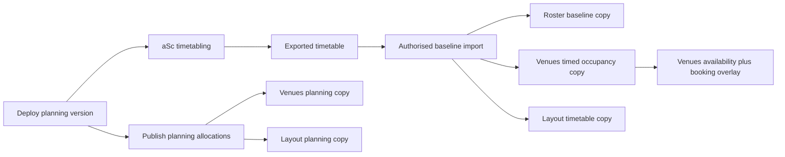

# Venue allocations, aSc timetable imports and booking overlays

Status: owner design record, 16 November 2026. Documentation only; implementation and Claude's exact-head review are pending. [Task and verification](../../coordination/tasks/v1-venue-allocation-lifecycle-design.md). Source inspection: main `d84a38ce907e7866f9331003ef4f26bb5a08851f`; the following `47b2d2c5da3d2cbb551259b44e2aa7536a2f79f9` changes only a review document.

## 1. Controlling owner decisions

The owner's final clarification controls the relationship between planning and timetable occupancy:

> The idea is NOT to link venues deploy to venues tightly. Deploy informs ASC, asc exports timetable, venues and roster takes from exported timetable.

The resulting requirements are:

1. Each Deploy planning version stores its own venue allocation set. Publishing or republishing replaces the Deploy-supplied allocation set held independently by Venues and Layout. Replacement takes effect immediately, including when the planning version is labelled for a future term; do not retain an older Deploy allocation set according to today's date.
2. The exported aSc timetable supplies actual dates/periods and room occupancy. Import updates Roster, Venues and Layout immediately through their existing import/adoption paths. No matching Deploy publication, attachment to a Deploy draft, or further Publish/Republish is a prerequisite.
3. Layout provides a quick view of class/teaching-group arrangements and the imported timetable. Venues owns booking operations as an overlay on immutable source snapshots. Neither edits a received source snapshot in place.
4. ISH-1A and ISH-1B represent **one physical venue, ISH-1, with two interchangeable class slots**, not two separately bookable physical rooms. Preserve the aSc labels for import/export and explanation.
5. Venues offers **one class slot** or **whole venue**; default to whole venue. Whole venue uses all available class slots and cannot coexist with another unwaived use of that venue.
6. A new source update may conflict with an existing booking. Keep the booking and flag the conflict for resolution. The new timetable remains in force. Do not silently cancel, displace, delete or move the booking.

These are all five owner answers plus the subsequent pipeline correction. There are no remaining owner questions for this document. The first description of a timed, Deploy-supplied version is refined by that correction: Deploy supplies **planning allocations**; aSc supplies **timed occupancy**. Both received snapshots are immutable. Do not turn the initial wording into a requirement to republish Deploy after timetable import.

## 2. Two source streams, independently owned copies

Publication replaces the **planning copy**, not the separate imported timetable, booking overlay, physical-map geometry or history. An aSc import replaces/adopts the **timed source** within its declared coverage, not Deploy drafts or bookings. This separation implements the owner's correction and prevents a future-labelled planning publication from inventing future timings or erasing valid imported lessons.

| Data or transition | Write owner and boundary |
| --- | --- |
| Physical venue identity and facts | Existing Venues physical-room register: stable school-scoped venue ID, display names and room metadata. Other apps can retain copies; names and aliases are not IDs. This design does not move the register into Deploy. |
| Planning allocations | Each Deploy version owns its class/TG-to-venue assignments and the referenced alias/mapping snapshot used for aSc planning. Other drafts are isolated. Publication freezes a new edition; later edits do not rewrite it. |
| Exported timetable and import identity | Preserve the original aSc artifact/digest, import operation, period/date model and explicit mappings using Roster's existing baseline import ownership. Consumers receive the resulting immutable import edition. Import does not need Deploy to be reachable. |
| Operational timetable | Roster holds its imported baseline and existing effective daily overrides. Venues and Layout each hold their own adopted timetable projection with source references. A consumer does not edit the source artifact. |
| Booking overlay | Venues owns booking series/occurrences, requested slot count or whole-venue intent, approvals, changes, closures, waivers and conflict resolution. Preserve existing capability and audit rules. |
| Presentation and local facts | Layout owns geometry and its existing local annotations. Publication/import updates source-owned allocations only. User-facing projections omit private staff details. |

Keep the existing shared acquisition/receipt path rather than inventing a second competing timetable parser. If an import is initiated from another viewport, route the command to the same baseline owner. Venues and Layout need neither a synchronous Deploy read for each request nor a globally matching Deploy revision to use a verified import. A recorded Deploy reference may be useful provenance; its absence or an unrelated Deploy edit is not an import, booking or Roster blocker.

## 3. Split labels and occupancy units

Use the existing physical venue ID plus an explicit alias map. Separate `classSlotCapacity` from pupil/seating capacity; the latter cannot establish how many simultaneous classes are allowed. The names here describe the contract, not a mandated migration schema.

| Timetable label | Physical venue | Occupancy demand |
| --- | --- | --- |
| ISH-1A | ISH-1's stable ID | One class slot |
| ISH-1B | The same ISH-1 ID | One class slot |
| Whole-venue booking | The same ISH-1 ID | Exclusive use of all class slots |

A/B are interchangeable scheduling labels. Do not create two physical-room records, draw two independent buildings, or use their names to infer permanently assigned halves. An exact configured alias may identify the parent and one unit of demand. Never strip the last letter of every room name, guess from a hyphen, infer slots from seating capacity or treat an ambiguous alias as two real rooms.

Preserve raw source labels and the mapping revision used by each import. A later alias edit does not retrospectively rewrite old imports; explicit reconciliation creates a new immutable mapped edition from the preserved source. A multi-room cell is a list of physical resource demands, not a newly invented room whose name contains punctuation. An explicit mapping must distinguish simultaneous use of several rooms from alternative spelling for one room. Preserve unresolved input for correction rather than dropping it or silently changing labels.

Preserve one identity per actual lesson/event. The same lesson repeated in teacher and class views, or shown for two co-teachers, must count once. Two distinct lessons at the same venue/time must count twice. Do not deduplicate by `venueId + start + end`: that loses one of the two classes in ISH-1. Where the export lacks enough identity to decide whether rows are duplicate views or separate events, retain the ambiguity and request mapping correction; do not invent certainty.

## 4. Adoption and display

**Deploy publication:** capture the saved version's complete planning allocation set. Deliver it to both consumers with version ID, publication ID, sequence and digest. Each consumer replaces its active planning pointer immediately with that snapshot. A clear/omission in a complete replacement removes that source-owned planning assignment from the active set; it does not delete the physical room, an imported lesson, a booking or historical evidence. Ordinary partial saves still distinguish an omitted field from an explicit clear.

**Baseline import:** preserve and validate the exported timetable, exact room mapping, dates, period timings and cycle rules, then commit an immutable baseline edition and delivery intents. Begin adoption immediately, without a Deploy publication ceremony. Use the timetable's real coverage; importing a future-dated schedule does not make its lessons occur today. Outside verified imported coverage, availability is unknown rather than proven free. Preserve existing baseline selection rules for overlapping imported ranges and publish their selected import IDs in the consumer projection; this task does not redesign those rules.

**No hidden link between the two:** a new Deploy planning publication does not invalidate an unchanged imported timetable, force reimport, back-write aSc or make that timetable a publication of Deploy. A later import can reflect different room use from the planning map. Show the source distinction; imported occupancy governs dated availability. Do not create a two-way synchronisation loop.

**Layout:** the planning view uses the latest published allocation set. A selected-date timetable view uses the adopted aSc timetable and any existing supported effective Roster projection. Display ISH-1 once, with its concurrent lessons and original A/B labels available in details. Preserve Layout geometry, local notes and other local facts when adopting either stream. A source disagreement can be flagged without refusing the source data or pretending it was reconciled.

**Roster:** retain existing daily effective timetable/Stapler and movement semantics. A teacher absence alone never releases a venue. Existing daily overrides remain dated overlays and do not mutate the baseline or Deploy. This document changes neither allocation policy nor automatic-publication eligibility.

“Immediately” means the accepted import/publication starts its durable delivery without an extra owner step, not an atomic write across all databases. Until adoption finishes, each viewport identifies its last adopted edition and pending/failed update. Never display a completed source receipt as proof that both consumers have applied it.

## 5. Booking capacity and new clashes

For every affected time segment, combine distinct timed lessons, held bookings, confirmed reservations from other existing sources, closures and applicable setup/cleanup buffers. A new one-slot reservation may commit only if its demand fits the venue's concurrent class-slot capacity throughout the requested interval. A whole-venue reservation excludes all other applicable uses. Keep pupil capacity separate. A booking spanning several periods must fit in every period; average spare capacity is insufficient.

For a two-slot ISH-1:

- No existing use: allow either one-slot or whole-venue booking.
- One lesson: one slot remains; a whole-venue booking conflicts.
- Two distinct concurrent lessons: no spare slot.
- One whole-venue booking: no additional lesson/booking can be described as conflict-free.

Keep existing approvals and precisely scoped waivers; they do not waive another booking, a closure or a missing capability. Unknown slot capacity or unresolved occupancy must not be represented as free capacity. Allow saving the underlying imported data and report incomplete availability for the affected scope. Do not block unrelated rooms or ordinary Deploy editing.

An incoming authoritative timetable is accepted even if it conflicts with an earlier booking. In the same Venues adoption transaction, record the new active source and its affected booking conflicts. Keep the booking's identity, owner, requested time, approval history and original saved details. Record conflict status separately; show it prominently in the booking list/details and availability view. Held bookings continue to count while unresolved, so a new request cannot exploit the overlap as spare capacity. Recheck the conflict against the current timetable when an authorised user resolves it.

The user may amend, move, cancel or use an existing permitted resolution route. None happens automatically. Completed/past booking history remains unchanged. A source capacity decrease, removed room mapping or changed alias cannot silently delete a booking. Any newly requested notification policy is a separate decision; this document requires visible conflicts and does not authorise provider sends.

## 6. Identity, concurrency and recovery

Reuse existing owner stores, receipts, immutable artifacts and delivery records. A projection records school, source kind, source operation/edition ID, digest, mapping revision, declared coverage and current adoption sequence. Store content identity separately from when it was received or checked. Retrying or reading unchanged facts does not create a new source edition.

Each owning database commits its state and receipt atomically. The source records durable consumer-delivery intents with its committed edition. Consumers verify source identity/digest and adopt idempotently; replay returns the recorded outcome, and an older delayed delivery cannot overwrite a newer edition of the same stream. Planning and timed streams have separate ordering, so a delayed planning acknowledgement cannot replace a timetable. Changed intent under one operation ID is rejected. Lost responses and restart recover the original receipt and pending deliveries rather than create duplicate imports or publications.

The Venues transaction serialises booking admission and timed-source adoption for the affected physical venue/time scope. If a booking wins first, later source adoption retains it with a conflict. If the source wins first, the booking is checked against the new occupancy. Two one-slot requests may both succeed when two units remain; two whole-venue requests cannot. Retain bounded, recoverable owner-side fencing where needed, without a cross-domain read lease that blocks ordinary Deploy saves.

No cross-D1 atomicity is claimed. Keep source adoption/version guards local to the owning database and expose incomplete delivery. A durable source unknown must be recovered; elapsed time alone is not proof of abort. Preserve existing school isolation, current capabilities, read-only impersonation, revision checks, intent binding and payload limits. No baseline import can grant publication or Admin authority. Use indexed queries and bounded/chunked projections already available; measure import/adoption and booking latency before declaring the implementation ready.

## 7. Current-code findings and implementation boundaries

These are static observations at the inspected main, not reproduced runtime failures:

| Evidence | Current behaviour and required consequence |
| --- | --- |
| [Deploy source projection](https://github.com/helper-gsps/gsis/blob/d84a38ce907e7866f9331003ef4f26bb5a08851f/v1/services/deploy/service.mjs#L2135) | Identifies a `planning-reference`. Keep planning-room references distinct from real timed occupancy; do not make them the required authority for imported timetable use. |
| [Roster mapping and occupancy construction](https://github.com/helper-gsps/gsis/blob/d84a38ce907e7866f9331003ef4f26bb5a08851f/v1/services/roster/service.mjs#L1065) | Supports one label mapped to several room IDs, but occupancy rows use room/start/end as a unique key. That representation cannot preserve two distinct simultaneous class demands in the same physical room. |
| [Venues conflicts](https://github.com/helper-gsps/gsis/blob/d84a38ce907e7866f9331003ef4f26bb5a08851f/v1/services/venues/domain.mjs#L275) | Uses same-room/overlap-group Boolean conflicts. Aliases and linked rooms exist, but are not a concurrent-class-slot admission model. |
| [Source activation](https://github.com/helper-gsps/gsis/blob/d84a38ce907e7866f9331003ef4f26bb5a08851f/v1/services/venues/domain.mjs#L1773) and [displacement](https://github.com/helper-gsps/gsis/blob/d84a38ce907e7866f9331003ef4f26bb5a08851f/v1/services/venues/domain.mjs#L441) | Pure domain activation calls `displace`, which changes conflicting held occurrences to `displaced`. The new owner rule requires retained bookings with explicit unresolved conflicts instead. Audit the real Worker path and SQL guards too; changing this helper alone is insufficient. |
| [Venues service](https://github.com/helper-gsps/gsis/blob/d84a38ce907e7866f9331003ef4f26bb5a08851f/v1/services/venues/service.mjs) and [staged import](https://github.com/helper-gsps/gsis/blob/d84a38ce907e7866f9331003ef4f26bb5a08851f/v1/services/venues/projection.mjs) | Already store source-specific occupancy and validate/fence imports. Pre-activation booking-conflict rejection and Boolean overlap guards must be reconciled with capacity and retained-conflict adoption. Preserve source integrity and concurrency rather than simply removing checks. |
| [Layout publication](https://github.com/helper-gsps/gsis/blob/d84a38ce907e7866f9331003ef4f26bb5a08851f/v1/services/layout/publication.mjs) | Adopts Deploy classes/TGs/venues by source identity while retaining local facts. Add a separate timed-source adoption/view rather than calling the planning allocation a complete timetable. |
| [v0.9 Venues domain](https://github.com/helper-gsps/gsis/blob/d84a38ce907e7866f9331003ef4f26bb5a08851f/shared/venues.js) | Existing alias, policy, transfer and source-history behaviour is useful reference. Its Boolean exclusivity and displacement policy do not override the owner's new requirements. |

This design controls the new split-slot and source-flow rules over conflicting wording in the [accelerated specification](../accelerated-delivery/GSIS_V1_ACCELERATED_IMPLEMENTATION_SPEC_2026-11-13.md), [publication recovery record](../accelerated-delivery/DEPLOY_VENUE_PUBLICATION_FIX_2026-11-15.md) and historical implementation evidence. It does not retroactively claim those releases implemented this design. It does not change the independent [Contacts lifecycle](../contacts/CONTACTS_LIFECYCLE_DESIGN.md) or turn venue timing into future-effective Contacts policy.

Implementation must use fresh, bounded claims and small PRs: first map/prove the current built import path with synthetic data; then add alias/demand preservation and capacity contracts; then local booking/adoption/conflict behaviour; then Layout/source-display integration and regression evidence. Exact file allowlists belong in those claims after refreshing overlapping work. This document authorises none of those code changes, migrations, imports, account/configuration changes or deployments.

## 8. Future acceptance evidence

All scenarios below are **Not tested**. Drive the real built browser, Worker and local D1 path with synthetic fixtures; helper-only assertions are supplementary. Include process restart and durable receipt checks. Hosted/runtime UAT is separate.

| ID | Observable scenario | Status |
| --- | --- | --- |
| V01 | Import ISH-1A and ISH-1B as two distinct simultaneous lessons: one physical venue, two demands, no duplicated map geometry. | Not tested |
| V02 | A co-taught lesson repeated in teacher/class export views counts once; two different lessons at identical room/time count twice. Ambiguous identity remains visible. | Not tested |
| V03 | With two free slots, two concurrent one-slot bookings succeed; a third fails without partial writes. | Not tested |
| V04 | Whole venue is the default and conflicts with one existing lesson or slot booking. Two concurrent whole-venue requests produce one accepted booking. | Not tested |
| V05 | Multi-period bookings, adjacent intervals, buffers, closures, linked physical resources and existing scoped waivers preserve their rules at each segment. | Not tested |
| V06 | Unknown/ambiguous aliases and unknown class-slot capacity retain imported records and mapping choices; affected availability is unresolved, never falsely free. | Not tested |
| V07 | Multi-room source cells consume each explicitly mapped physical resource; aliases for the same resource do not create phantom rooms or duplicate one lesson. | Not tested |
| V08 | Separate Deploy drafts retain different allocation sets; editing one does not change the other or an immutable published snapshot. | Not tested |
| V09 | A future-labelled Deploy publication replaces both active planning copies immediately; no date-based fallback to an older Deploy set. Imported occupancy and bookings remain intact. | Not tested |
| V10 | aSc import updates Roster/Venues/Layout without a Deploy publication or reachable Deploy service. Original artifact, mappings and real date/period coverage are recoverable. | Not tested |
| V11 | Missing/outdated Deploy linkage does not reject valid import or booking against a verified timetable. No fake timed occupancy is produced from a planning assignment. | Not tested |
| V12 | Later timetable import disagrees with planning allocations: timed availability uses the import; Layout identifies both sources and retains local geometry/notes. | Not tested |
| V13 | New timetable conflicts with a held booking: adoption succeeds, booking identity/details/history survive, and conflict is visible until authorised resolution. | Not tested |
| V14 | Booking-versus-import races in both orders yield a new-source conflict or admission against the new source, never silent deletion or an unreported overbooking. | Not tested |
| V15 | Unresolved held booking still consumes capacity; changing slot capacity, aliases or room inclusion flags affected bookings without auto-cancelling them. | Not tested |
| V16 | Import outside current date coverage and dates without verified coverage do not fabricate availability. Effective Roster movements still apply; absence alone does not free a room. | Not tested |
| V17 | Lost responses, exact retries and process restart recover one source edition, one booking and each independent adoption receipt without duplicate effects. | Not tested |
| V18 | One consumer unavailable: source commit remains recorded, other consumers work, pending delivery is visible, and later retry catches up without modifying immutable history. | Not tested |
| V19 | Delayed old editions, alias reconciliation and planning/timetable interleavings cannot roll back a newer pointer or mutate earlier source evidence. | Not tested |
| V20 | Wrong school, missing capability, stale booking revision, changed intent with reused operation ID, read-only impersonation and oversize input remain rejected. | Not tested |
| V21 | Planning publication or delayed consumer delivery never takes a reader lock that blocks ordinary Deploy editing. Recovery preserves the original operation IDs. | Not tested |
| V22 | Existing approval/transfer/waiver/calendar and notification deduplication paths remain valid; no new provider send is required to test visible conflicts. | Not tested |

Run the canonical build without tracked drift, focused browser/Worker/D1 tests, runner discovery, required existing Node/LORD/product regressions and exact-head CI for implementation. Record numeric latency/resource results and failures honestly. F5 remains **OPEN**; official T1B-01/T1B-02 and unperformed hosted/runtime UAT remain **Not tested**.
